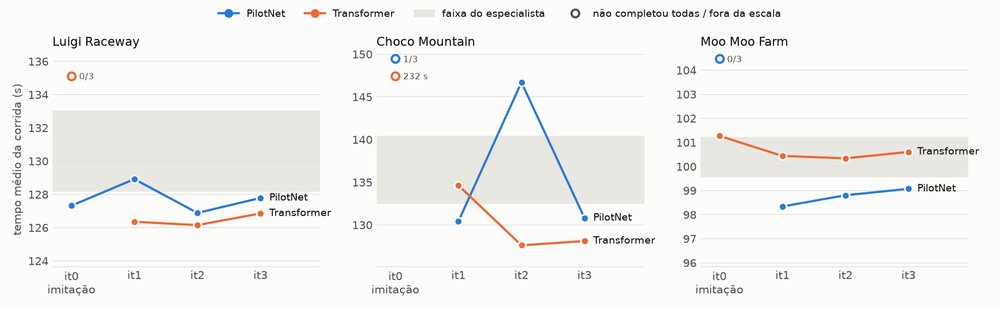

# Resultados

Gerado por `python -m nk.report` a partir de [`races.csv`](races.csv) (uma linha por corrida). Não edite este arquivo à mão.

Cada configuração foi testada com a rede **jogando sozinha** (3 corridas de 3 voltas, Time Trial, Mario). *Iteração 0* = só imitação do especialista; *1-3* = iterações de DAgger. Tempos em segundos de jogo; *completas* = corridas que terminaram as 3 voltas.

## Resumo

| Pista | Especialista | PilotNet só imitação | PilotNet após DAgger | Transformer só imitação | Transformer após DAgger | Mais rápido |
|---|---|---|---|---|---|---|
| Luigi Raceway | 128,2–133,0 s | 3/3 completas | 126,9 s (it2) | 0/3 completas | 126,2 s (it2) | empate |
| Choco Mountain | 132,4–140,4 s | 1/3 completas | 130,4 s (it1) | 3/3 completas | 127,6 s (it2) | Transformer (−2,8 s) |
| Moo Moo Farm | 99,5–101,2 s | 0/3 completas | 98,3 s (it1) | 3/3 completas | 100,3 s (it2) | PilotNet (−2,0 s) |

*Após DAgger* = a melhor média entre as iterações 1-3 em que as 3 corridas terminaram. *Empate* = diferença menor que 1 s.

<picture>
  <source media="(prefers-color-scheme: dark)" srcset="times-dark.png">
  
</picture>

## Luigi Raceway

Especialista: 6/6 corridas completas, 128,2 · 130,6 · 131,1 · 131,1 · 131,3 · 133,0 s (média 130,9 s).

| Iteração | PilotNet: completas | média | melhor | Transformer: completas | média | melhor |
|---|---|---|---|---|---|---|
| it0 (só imitação) | 3/3 | 127,32 | 125,95 | 0/3 (presa em ~0,50 volta) | — | — |
| it1 | 3/3 | 128,92 | 128,75 | 3/3 | 126,35 | 125,85 |
| it2 | 3/3 | 126,88 | 126,85 | 3/3 | 126,15 | 126,05 |
| it3 | 3/3 | 127,78 | 127,75 | 3/3 | 126,85 | 126,75 |

## Choco Mountain

Especialista: 6/6 corridas completas, 132,4 · 133,0 · 134,7 · 137,3 · 139,9 · 140,4 s (média 136,3 s).

| Iteração | PilotNet: completas | média | melhor | Transformer: completas | média | melhor |
|---|---|---|---|---|---|---|
| it0 (só imitação) | 1/3 (presa em ~2,29 volta) | 146,14 | 146,14 | 3/3 | 231,72 | 224,22 |
| it1 | 3/3 | 130,42 | 129,35 | 3/3 | 134,64 | 127,35 |
| it2 | 3/3 | 146,71 | 145,04 | 3/3 | 127,62 | 125,75 |
| it3 | 3/3 | 130,82 | 128,75 | 3/3 | 128,12 | 126,35 |

## Moo Moo Farm

Especialista: 6/6 corridas completas, 99,5 · 99,7 · 99,8 · 99,8 · 100,3 · 101,2 s (média 100,1 s).

| Iteração | PilotNet: completas | média | melhor | Transformer: completas | média | melhor |
|---|---|---|---|---|---|---|
| it0 (só imitação) | 0/3 (presa em ~0,54 volta) | — | — | 3/3 | 101,27 | 101,24 |
| it1 | 3/3 | 98,34 | 98,34 | 3/3 | 100,44 | 100,44 |
| it2 | 3/3 | 98,81 | 98,54 | 3/3 | 100,34 | 100,34 |
| it3 | 3/3 | 99,07 | 99,04 | 3/3 | 100,61 | 100,54 |

## Mario Raceway (sem comparação)

Especialista: 1/6 corridas completas. pista abandonada: o especialista sai da pista e para em muros (sem marcha a ré); interrupted = parada manual da coleta

| Corrida | Resultado | Voltas | Tempo (s) |
|---|---|---|---|
| 1 | stuck | 0,75 | 41,63 |
| 2 | stuck | 0,75 | 48,43 |
| 3 | stuck | 0,96 | 55,43 |
| 4 | finished | 3,00 | 129,75 |
| 5 | stuck | 2,96 | 131,55 |
| 6 | interrupted | 2,96 | 139,04 |

## Histórico: dados v1 (com o bug do frame extra)

Antes da correção da coleta, cada decisão do especialista tinha 1 frame extra sem nenhum botão, e as redes treinadas assim travavam ao jogar sozinhas. Ver o README principal.

| Data | Modelo | Run | Iteração | Checkpoint | Direção | Completas | Média | Observação |
|---|---|---|---|---|---|---|---|---|
| 2026-10-13 | Transformer | lr_v1 | 0 | model | media | 0/1 (presa em ~0,52 volta) | — |  |
| 2026-10-13 | Transformer | lr_v1 | 0 | last | media | 0/1 (presa em ~0,54 volta) | — |  |
| 2026-10-13 | Transformer | lr_v1 | 0 | model | greedy | 0/2 (presa em ~0,53 volta) | — |  |
| 2026-10-13 | Transformer | lr_v1 | 0 | last | greedy | 0/2 (presa em ~0,53 volta) | — |  |
| 2026-10-13 | PilotNet | lr_pilot | 0 | model | media | 0/2 (presa em ~0,46 volta) | — |  |
| 2026-10-14 | PilotNet | lr_pilot | 1 | model | media | 0/2 (presa em ~0,52 volta) | — |  |
| 2026-10-14 | PilotNet | lr_pilot | 3 | model | media | 3/3 | 125,32 |  |
| 2026-10-14 | PilotNet | lr_pilot | 3 | model | media | 1/1 | 125,35 | repetição assistida pelo usuário |
| 2026-10-14 | Transformer | lr_tf | 1 | model | media | 0/2 (presa em ~0,51 volta) | — |  |
| 2026-10-14 | Transformer | lr_tf | 2 | model | media | 0/2 (presa em ~0,52 volta) | — |  |
| 2026-10-14 | Transformer | lr_tf | 2 | last | media | 0/2 (presa em ~0,51 volta) | — |  |
| 2026-10-14 | Transformer | lr_tf | 2 | model | greedy | 0/2 (presa em ~0,52 volta) | — |  |
| 2026-10-14 | Transformer | lr_tf | 2 | model | media | 0/2 (presa em ~0,52 volta) | — | captura com espera mínima de 40 ms |
